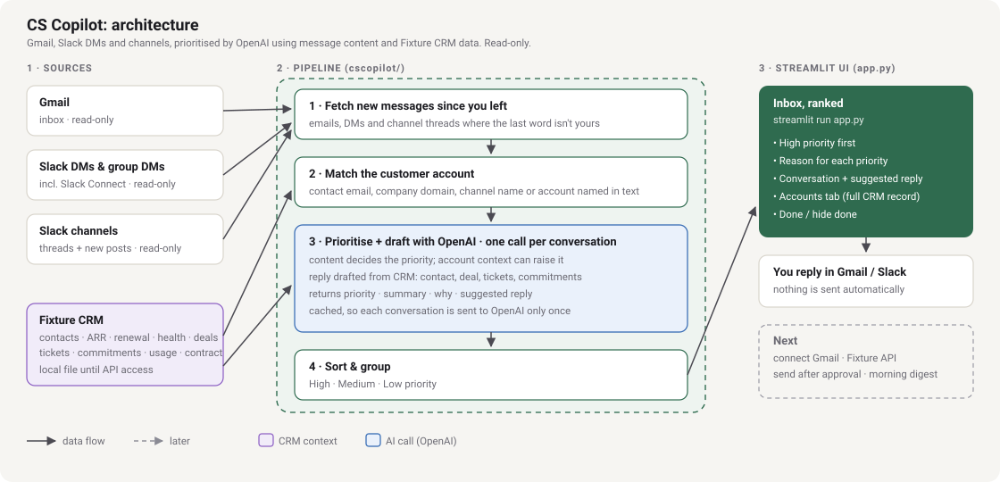

# CS Copilot

Pulls your Gmail, Slack DMs and Slack channel messages into one Streamlit page. OpenAI reads each conversation
together with the customer's account details from Fixture and marks it **High**, **Medium** or **Low** priority.
High priority comes first, with a short summary, the reason, and a suggested reply. Nothing is sent.



## Run
Double-click **`Open CS Copilot UI.bat`** and go to http://localhost:8501.
The **Sample data** switch shows a demo inbox if nothing is connected.

## Connect (`.env`)
| What | How |
|---|---|
| **OpenAI** | `OPENAI_API_KEY=`. Default model `gpt-6-luna`; change it with `OPENAI_MODEL`. |
| **Slack** | api.slack.com/apps → *From a manifest* → paste `slack_app_manifest.yaml` → Install → copy the **User OAuth Token** (`xoxp-…`) into `SLACK_USER_TOKEN`. Skip channels with `SLACK_EXCLUDE_CHANNELS=social,random`. |
| **Gmail** | Google Cloud Console → enable the Gmail API → OAuth client (Desktop app) → save the JSON as `.secrets/google_client_secret.json`. The first fetch opens a browser to sign in. |
| **Fixture** | `FIXTURE_API_KEY` + `FIXTURE_ACCOUNTS_URL`, then map the response in `cscopilot/fixture.py`. Until then, edit `data/fixture_accounts.json`. Add `contact_emails` to link specific people to an account. |

Without an OpenAI key, simple keyword rules are used instead.

## What gets fetched
- **Email**: inbox threads where the latest message isn't from you.
- **Slack DMs and group DMs**: conversations where the other person spoke last.
- **Slack channels you're in** (including Slack Connect): threads with new replies where you didn't reply last, and
  new top-level posts (up to 15 per channel, `SLACK_MAX_PER_CHANNEL`).

## How priority is decided
- **High**: customer blocked, security issue, churn risk or escalation, a promise due today, a direct customer ask,
  renewal or deal work, a near deadline.
- **Medium**: questions or requests with no near deadline; colleagues needing input.
- **Low**: thanks, social, newsletters, channel chatter not aimed at you.
- **Account context** (renewal within 60 days, health watch or at risk, high ARR) can move a relationship message up.
  It never moves social or automated messages up.
- Results are cached in `data/.score_cache.json`, so each message is only sent to OpenAI once.

## What we send to the AI from Fixture
Built in `cscopilot/fixture.py::llm_context`. Each card's **CRM context sent to the AI** shows exactly what went with that message.

| Field | Used for |
|---|---|
| `contacts[]` (name, role, email, notes) | Find who sent it, greet them by their real name, match their style ("prefers short updates") |
| `arr_gbp`, `plan`, `renewal_date`, `health`, `health_reason`, `stage` | Priority (renewal soon, at risk) and tone |
| `deals[]` (stage, amount, close date, next step, owner) | "Proposal sent, next step is security sign-off" |
| `tickets[]` (status, priority, ETA) | Honest status on bugs; no dates that aren't confirmed |
| `commitments[]` (what, owner, due) | "I'll send the rollout plan by 17 October" |
| `usage` (seats, adoption, obligations mapped, features) | Value proof in renewal and competitor conversations |
| `contract` (SLA, entitlements, pricing rule) | "SCIM is in your plan"; pricing always goes to the AE |
| `team` (CSM, AE, SE) | Who to name for pricing or technical follow-up |
| `recent_activity[]` | What was said last time |
| `risks[]`, `talking_points[]` | Approved positioning when a competitor comes up |

Rules in the prompt: use only the one or two facts that matter for that message, never quote prices, never promise
dates the CRM doesn't confirm, and never invent facts.

## Files
```
app.py                       Streamlit UI
cscopilot/inbox.py           fetch → match account → prioritise → sort
cscopilot/sources/gmail.py   Gmail (read-only)
cscopilot/sources/slack.py   Slack DMs, group DMs, channels (read-only)
cscopilot/sources/sample.py  sample inbox
cscopilot/fixture.py         Fixture accounts and matching
cscopilot/scorer.py          OpenAI prioritisation (+ keyword fallback, cache)
data/                        Fixture stand-in, sample inbox, local state
```

## Before using real customer data
Get your company's approval to send customer emails and Slack messages to OpenAI, and use a company API key.
